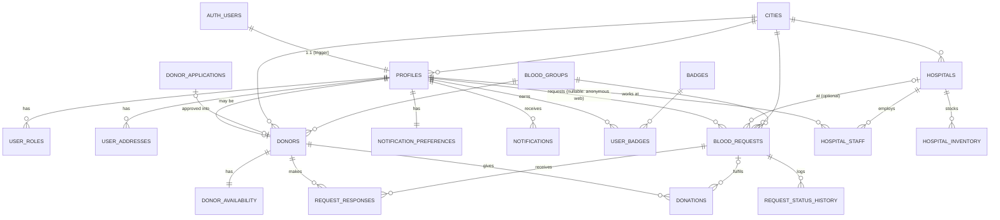

# Database schema

Postgres 17 (Supabase). Source of truth: `supabase/migrations/`. All tables live in `public`, use UUID keys (except lookups and logs), and have `created_at`. Mutable tables also have `updated_at` maintained by trigger.

## Entity relationships

## Tables

| Table | Purpose | Key constraints |
|---|---|---|
| `blood_groups` | 8 groups + `can_donate_to` / `can_receive_from` | PK `code`, check in 8 values |
| `cities` | Normalised cities; website free text resolved via `resolve_city()` | unique `name_key` (lower/trimmed) |
| `badges` | Badge catalogue (metric + threshold) | PK slug |
| `profiles` | One per auth user: name, phone, blood group, city/area, account type, verified, status | PK = `auth.users.id` (cascade), unique email |
| `user_roles` | `admin` / `moderator` / `hospital_staff` | PK (user, role) |
| `user_addresses` | Optional saved addresses | one `is_primary` per user (partial unique) |
| `donor_applications` | Website "Become a Donor" submissions | one **pending** application per email (partial unique) |
| `donors` | Discoverable donors; linked to a profile **or** standalone (website-approved) | unique `profile_id`, unique email; identity check when unlinked |
| `donor_availability` | Current status: available / resting / busy | PK `donor_id` |
| `hospitals` | Partner hospitals | unique (name, city) |
| `hospital_inventory` | Units per hospital × blood group | PK (hospital, group), units ≥ 0 |
| `hospital_staff` | Which staff manage which hospital | PK (user, hospital) |
| `blood_requests` | All requests from website, app and admin (`source`) | `reference_code` unique (`BR-YYYY-000001`), units 1–10, enums for status/urgency/source |
| `request_status_history` | Every status change with actor and reason | FK request (cascade) |
| `request_responses` | Donor ↔ request responses | unique (request, donor) |
| `donations` | Donation records (self-reported → verified by staff) | certificate unique, one per (request, donor), date ≤ today |
| `user_badges` | Earned badges (awarded by trigger) | PK (user, badge) |
| `notifications` | In-app notifications | indexes on (user, created_at), unread partial |
| `notification_preferences` | Alerts, visibility, search radius | PK user, radius ∈ {5,10,25,50} |
| `device_push_tokens` | Future push notifications | PK token |
| `contact_messages` | Website contact form | email/phone format checks |
| `audit_logs` | Row-level change log (trigger) | indexed by (table, record, time) |
| `admin_activity_logs` | Human-readable admin actions (RPC) | indexed by time and target |

### Enums
`account_type`, `account_status`, `app_role`, `availability_status`, `gender`, `request_status`, `request_urgency`, `request_source`, `response_status`, `application_status`, `hospital_type`, `donation_status`, `notification_type`.

### Validation in the database
- Domains: `phone_text` (`+`, digits, spaces, `()`, `-`; 7–23 chars) and `person_name` (2–100 chars).
- Checks: ages 17–65, units 1–10 (requests) / 1–2 (donations), weight 20–300, coordinates, text length limits, email format.
- RPCs add friendly messages, normalisation (trim, collapse spaces, upper-case blood group, city resolution), rate limits and the 56-day donation interval.

### Derived values (not stored, computed by functions)
- Donation count, last donation, lives saved (`units × 3`), and next eligible date (last + 3 months): `get_my_summary()`, `search_donors()`.
- Stock level: critical ≤ 2, low ≤ 6, good > 6 (clients and dashboard; `critical_stock` in stats).

## Field mapping from existing clients

| Website (localStorage) | Database |
|---|---|
| `ld_users {firstName,lastName,email,password,userType}` | Supabase Auth user + `profiles` (metadata `first_name`, `last_name`, `user_type`). Passwords are **never** migrated. |
| `ld_donor_requests` | `donor_applications` |
| `ld_donors` | `donors` (standalone) + `donor_availability` |
| `ld_requests {patientName,bloodGroup,contactNumber,hospitalName,city,urgent,status}` | `blood_requests` (`source='website'`, `units=1`, `urgency=urgent/normal`, `contact_name=patient`, status `pending→pending`, `fulfilled→fulfilled`, `cancelled→cancelled`) |
| `ld_messages` | `contact_messages` |

| App (mock store) | Database |
|---|---|
| `UserProfile` | `profiles` (+ `donors`, `donor_availability`) |
| `BloodRequest {urgency, status active/fulfilled, isMine}` | `blood_requests` (`requester_id = me`) |
| `Donation` | `donations` |
| `AppNotification` | `notifications` |
| `AppSettings` | `notification_preferences` |
| `Badge` (earnedAt/progress) | `badges` + `user_badges` (progress computed from counts) |
